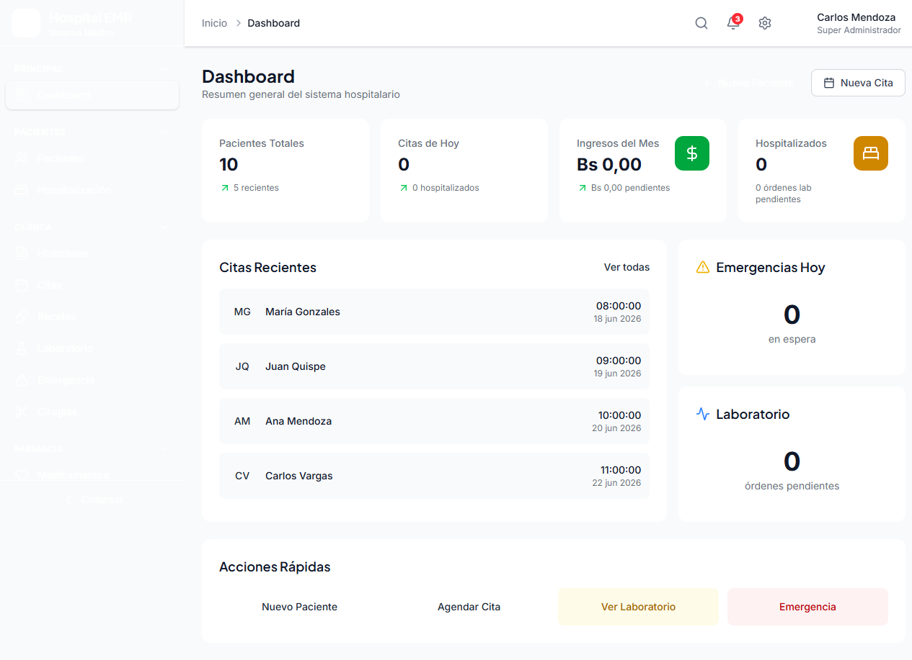
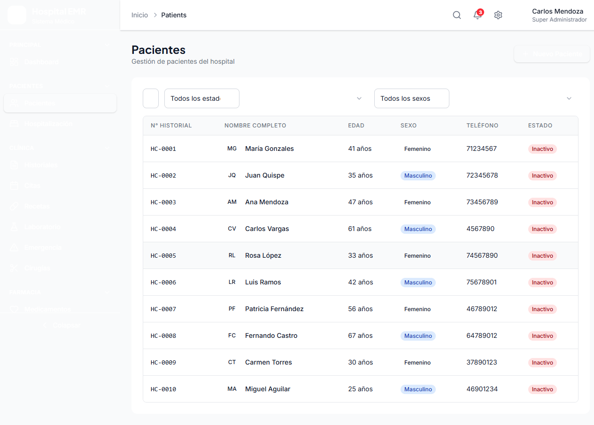
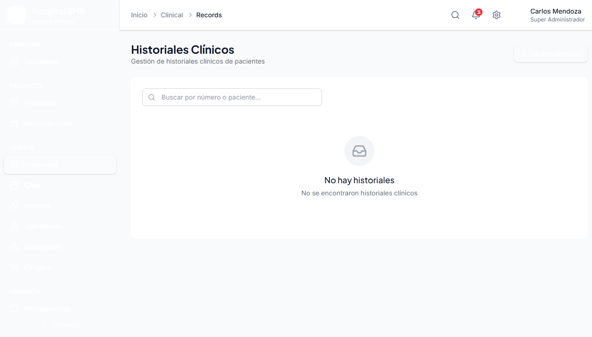
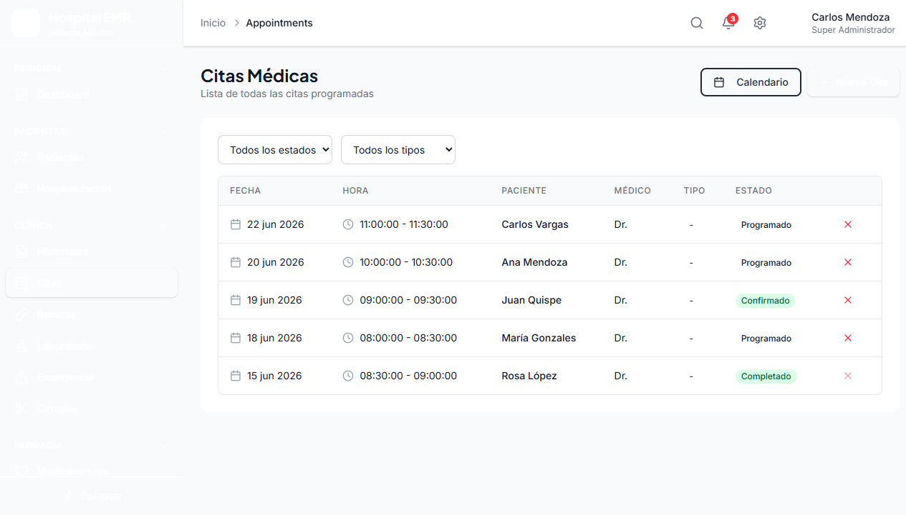
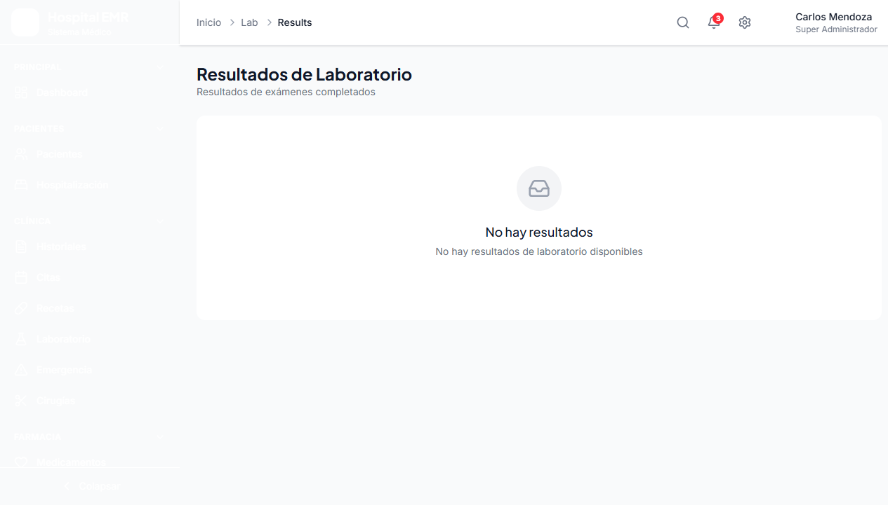
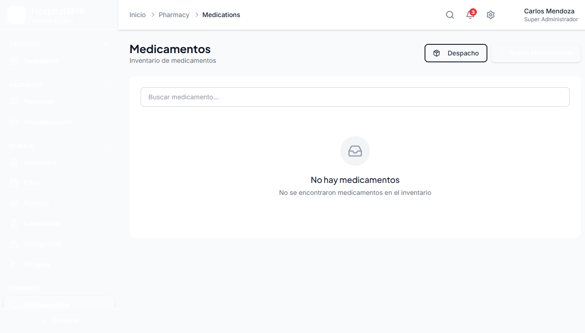
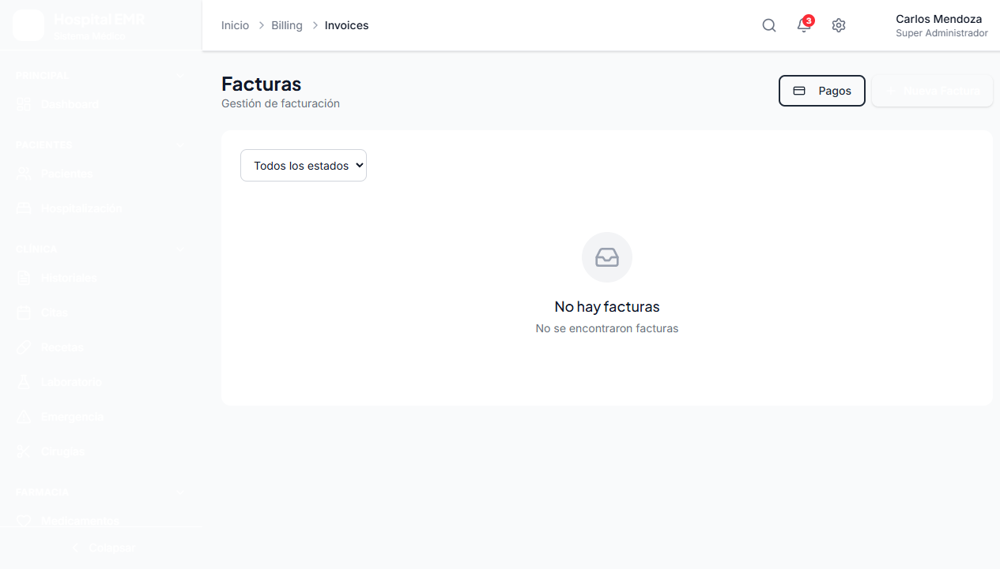
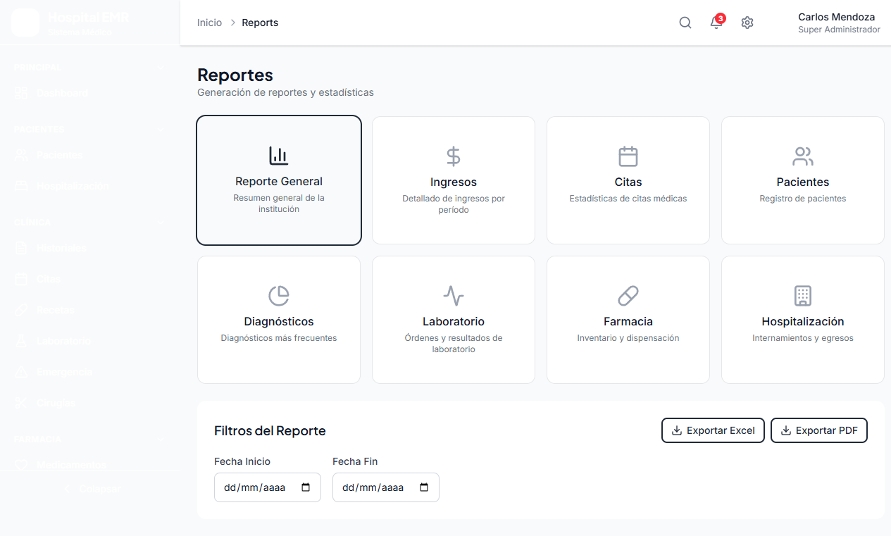

<div align="center">

# 🏥 Hospital EMR/EHR System

### Sistema Integral de Historias Clínicas Electrónicas

[](https://laravel.com)
[](https://react.dev)
[](https://mysql.com)
[](https://tailwindcss.com)
[](https://typescriptlang.org)
[](https://jwt.io)

**Arquitectura completa para gestión hospitalaria — diseñada para Bolivia, escalable para Latinoamérica**

[Ver Demo](#-demo) · [Documentación API](#-api-documentation) · [Arquitectura](#-architecture) · [Instalación](#-quick-start)

</div>

---

## 📋 Table of Contents

- [Demo](#-demo)
- [Overview](#-overview)
- [Key Features](#-key-features)
- [Architecture](#-architecture)
- [Tech Stack](#-tech-stack)
- [Project Structure](#-project-structure)
- [Database](#-database)
- [API Documentation](#-api-documentation)
- [Quick Start](#-quick-start)
- [Modules](#-modules)
- [Security](#-security)
- [Deployment](#-deployment)
- [Author](#-author)

---

## 🖼 Demo

### Dashboard


### Pacientes


### Historial Clínico


### Citas Médicas


### Laboratorio


### Farmacia


### Facturación


### Reportes


---

## 🎯 Overview

A **full-stack Electronic Medical Records (EMR) / Electronic Health Records (EHR) system** built from scratch with a decoupled architecture. Designed specifically for the Bolivian healthcare system with SIN (Servicio de Impuestos Nacionales) billing compliance, CIE-10 diagnostic coding, and BOB currency support.

### Numbers

| Metric | Value |
|--------|-------|
| Database Tables | **108** |
| API Endpoints | **150+** |
| Frontend Pages | **47** |
| Backend Controllers | **39** |
| Service Classes | **12** |
| Eloquent Models | **100+** |
| Database Migrations | **110+** |
| UI Components | **15** |
| Custom Hooks | **12** |
| API Tests | **77/77 passing** |

---

## ✨ Key Features

### Clinical
- **Patient Management** — Complete profiles: demographics, contacts, allergies, insurance, medical history
- **Medical Records** — SOAP notes, clinical evolutions, vital signs, treatment plans
- **Appointments** — Scheduling with doctor availability, reminders, calendar view
- **Prescriptions** — Electronic prescribing with medication catalog and dosage management
- **Laboratory** — Lab orders, result entry with reference ranges, specimen tracking
- **Radiology** — Imaging orders, result recording, PACS integration support
- **Diagnosis** — CIE-10/ICD-10 coding system with 50+ pre-loaded codes

### Hospital Operations
- **Hospitalization** — Admission, bed management, transfers, discharge planning
- **Surgery** — OR scheduling, team assignment, materials tracking, surgery reports
- **Emergency** — Triage system with priority-based queuing and protocols
- **Pharmacy** — Medication inventory, batch tracking, dispensation, low-stock alerts
- **Inventory** — Medical supplies and equipment management

### Financial
- **Billing** — Invoice generation (FAC-000001 sequential), payment processing
- **Cash Register** — POS operations with cash movement tracking
- **Insurance** — Claims processing and discount authorizations
- **Reports** — Revenue analytics, monthly reports, export capabilities

### System
- **Multi-Institution** — Shared database, isolated data per institution
- **RBAC** — Granular permissions for admin, doctor, nurse, billing, lab, pharmacy roles
- **Audit Logging** — Complete activity tracking for HIPSSA/SOAP compliance
- **JWT Authentication** — Secure token-based auth with refresh and MFA support
- **Print Pages** — Dedicated print views for invoices, prescriptions, lab results

---

## 🏗 Architecture

```
┌─────────────────────────────────────────────────────────────┐
│                     PRESENTATION LAYER                       │
│  ┌─────────────┐  ┌──────────────┐  ┌───────────────────┐  │
│  │ React 19    │  │ Tailwind v4  │  │ React Query       │  │
│  │ TypeScript  │  │ Custom Theme │  │ State Management  │  │
│  └─────────────┘  └──────────────┘  └───────────────────┘  │
└──────────────────────────┬──────────────────────────────────┘
                           │ REST API (JSON)
┌──────────────────────────▼──────────────────────────────────┐
│                     APPLICATION LAYER                        │
│  ┌─────────────┐  ┌──────────────┐  ┌───────────────────┐  │
│  │ Controllers │→ │ Services     │→ │ Repositories      │  │
│  │ 39 endpoints│  │ Business     │  │ Data Access       │  │
│  │ Validation  │  │ Logic        │  │ Eloquent ORM      │  │
│  └─────────────┘  └──────────────┘  └───────────────────┘  │
└──────────────────────────┬──────────────────────────────────┘
                           │
┌──────────────────────────▼──────────────────────────────────┐
│                       DATA LAYER                             │
│  ┌─────────────┐  ┌──────────────┐  ┌───────────────────┐  │
│  │ MySQL 8.0   │  │ 108 Tables   │  │ Stored Procedures │  │
│  │ XAMPP       │  │ 110 Migr.    │  │ Views             │  │
│  └─────────────┘  └──────────────┘  └───────────────────┘  │
└─────────────────────────────────────────────────────────────┘
```

### Design Patterns
- **Repository Pattern** — Abstracted data access layer
- **Service Layer** — Separated business logic from HTTP concerns
- **DTO Pattern** — Typed data transfer objects for API contracts
- **API Versioning** — `/api/v1/` prefix for backward compatibility
- **Middleware Pipeline** — CORS, JWT Auth, Rate Limiting, Audit Logging

---

## 🛠 Tech Stack

### Backend
| Component | Technology |
|-----------|------------|
| Framework | Laravel 11 |
| Language | PHP 8.2 |
| Database | MySQL 8.0 (XAMPP) |
| Authentication | JWT (tymon/jwt-auth) |
| Architecture | Clean Architecture + DDD |
| Patterns | Repository, Service Layer, DTO |

### Frontend
| Component | Technology |
|-----------|------------|
| Framework | React 19 |
| Language | TypeScript 5.x |
| Build Tool | Vite 6 |
| Styling | Tailwind CSS v4 |
| State | React Query + Context |
| Forms | React Hook Form + Zod |
| Routing | React Router v6 |
| Charts | Chart.js |

### DevOps
| Component | Technology |
|-----------|------------|
| Version Control | Git + GitHub |
| Testing | Playwright (E2E) |
| Deployment | Hostinger Shared Hosting |
| CI/CD | GitHub Actions (planned) |

---

## 📁 Project Structure

```
hospital/
├── backend/                         # Laravel 11 REST API
│   ├── app/
│   │   ├── DTOs/                    # Data Transfer Objects (12)
│   │   ├── Enums/                   # PHP Enums (35)
│   │   ├── Http/
│   │   │   ├── Controllers/V1/      # API Controllers (39)
│   │   │   ├── Middleware/           # Request Middleware (7)
│   │   │   └── Requests/            # Form Request Validation
│   │   ├── Models/                  # Eloquent Models (100+)
│   │   ├── Providers/               # Service Providers
│   │   ├── Repositories/            # Repository Pattern
│   │   │   ├── Eloquent/            # Concrete Implementations
│   │   │   └── Interfaces/          # Contracts
│   │   └── Services/                # Business Logic (12)
│   │       ├── Appointment/
│   │       ├── Auth/
│   │       ├── Billing/
│   │       ├── Clinical/
│   │       ├── Laboratory/
│   │       ├── Patient/
│   │       └── Pharmacy/
│   ├── database/
│   │   ├── migrations/              # 110+ migrations
│   │   ├── procedures/              # Stored procedures
│   │   ├── seeders/                 # Database seeders (24)
│   │   └── views/                   # Database views
│   ├── routes/api.php               # 150+ API routes
│   └── tests/                       # Backend tests
│
├── frontend/                        # React 19 SPA
│   ├── src/
│   │   ├── components/
│   │   │   ├── layout/              # AppLayout, Header, Sidebar
│   │   │   └── ui/                  # Reusable UI (15 components)
│   │   ├── hooks/                   # Custom React Hooks (12)
│   │   ├── lib/                     # API client, utilities
│   │   ├── pages/                   # Page Components (47)
│   │   │   ├── dashboard/
│   │   │   ├── patients/
│   │   │   ├── clinical/
│   │   │   ├── appointments/
│   │   │   ├── laboratory/
│   │   │   ├── prescriptions/
│   │   │   ├── billing/
│   │   │   ├── pharmacy/
│   │   │   ├── hospitalization/
│   │   │   ├── emergency/
│   │   │   ├── surgery/
│   │   │   ├── radiology/
│   │   │   ├── reports/
│   │   │   ├── settings/
│   │   │   └── auth/
│   │   ├── router/                  # Route configuration
│   │   ├── styles/                  # Tailwind + print CSS
│   │   ├── types/                   # TypeScript type definitions
│   │   └── validations/             # Zod validation schemas
│   └── tailwind.config.js           # Custom theme (teal/green/orange)
│
├── installer/                       # Web-based installer
├── database.sql                     # Full database export (493 KB)
├── docs/                            # Documentation
│   ├── API.md
│   ├── ARCHITECTURE.md
│   ├── DATABASE.md
│   ├── DEPLOYMENT.md
│   └── INSTALLATION.md
└── screenshots/                     # 65+ UI screenshots
```

---

## 🗄 Database

### Schema Overview

**108 tables** covering all hospital operations:

| Domain | Tables | Key Entities |
|--------|--------|-------------|
| Patients | 6 | patients, contacts, allergies, documents, insurances |
| Clinical | 8 | medical_records, consultations, diagnoses, soap_notes, evolutions, vital_signs |
| Appointments | 4 | appointments, slots, doctor_schedules, reminders |
| Laboratory | 5 | lab_orders, lab_order_items, lab_results, specimens |
| Pharmacy | 6 | medications, batches, dispensations, suppliers, purchase_orders |
| Billing | 8 | invoices, invoice_items, payments, cash_registers, cash_movements |
| Hospitalization | 5 | hospitalizations, bed_transfers, hospitalization_evolutions |
| Surgery | 5 | surgery_schedules, surgery_team, surgery_materials, surgery_reports |
| Emergency | 4 | emergency_triage, emergency_records, triage_protocols |
| System | 15+ | users, roles, permissions, audit_logs, settings, institutions |

### Database Features
- **Stored Procedures** — `sp_patient_stats`, `sp_monthly_revenue`, `sp_appointment_stats`, etc.
- **Views** — `v_dashboard_summary`, `v_bed_occupancy`, `v_top_diagnoses`, etc.
- **Soft Deletes** — Institutions, patients, and key entities
- **Audit Trail** — Timestamps and user tracking on all operations

Full schema documentation: [docs/DATABASE.md](docs/DATABASE.md)

---

## 📡 API Documentation

### Authentication

```bash
# Login
POST /api/v1/auth/login
{
  "email": "admin@hospital.bo",
  "password": "password"
}

# Response
{
  "success": true,
  "data": {
    "access_token": "eyJ0eXAiOiJKV1Qi...",
    "token_type": "bearer",
    "expires_in": 3600
  }
}
```

### Endpoints

| Module | Method | Endpoint | Description |
|--------|--------|----------|-------------|
| Auth | POST | `/auth/login` | Login |
| Auth | POST | `/auth/logout` | Logout |
| Auth | GET | `/auth/me` | Current user |
| Users | GET | `/users` | List users |
| Users | POST | `/users` | Create user |
| Patients | GET | `/patients` | List patients |
| Patients | POST | `/patients` | Create patient |
| Patients | GET | `/patients/{id}/medical-history` | Medical history |
| Appointments | GET | `/appointments` | List appointments |
| Appointments | POST | `/appointments` | Create appointment |
| Lab Results | GET | `/lab-results/{id}` | Get lab result |
| Prescriptions | GET | `/prescriptions` | List prescriptions |
| Invoices | GET | `/invoices` | List invoices |
| Medications | GET | `/medications` | List medications |
| CIE-10 | GET | `/cie10` | Search CIE-10 codes |
| Institution | GET | `/institution` | Get institution |
| Dashboard | GET | `/dashboard/stats` | Dashboard statistics |

**150+ endpoints total** — Full documentation: [docs/API.md](docs/API.md)

---

## 🚀 Quick Start

### Docker (recommended)

Docker builds and runs both services, creates the SQLite database, runs all migrations,
and seeds the demo data automatically on first start.

```bash
docker compose up -d --build      # build images and start API (:8000) + web (:3000)
docker compose logs -f            # follow logs from both services
docker compose down               # stop containers (database volume is preserved)
docker compose down -v            # stop and delete the database volume (fresh reset)
```

Open **http://localhost:3000** and sign in with `admin@hospital.bo` / `password`.
The API is available at **http://localhost:8000/api/v1** (and `/api/v1/health`).

Requirements: Docker Engine with the Compose plugin. No PHP, Composer, or Node.js
installation is needed on the host. To access the database from outside, the API
uses a named volume (`api-db`) so data survives container restarts.

### Local development (recommended)

The repository ships with a pre-seeded SQLite database, so MySQL is not required to run the system locally.

```bash
npm install   # one time, installs the dev launcher
npm start     # starts the API (:8000) and the web app (:3000)
```

Open **http://localhost:3000** and sign in with `admin@hospital.bo` / `password`.
`npm start` runs both servers in one terminal; press `Ctrl+C` to stop them. To run them
separately instead, use `npm run api` and `npm run web` in two terminals.

### Prerequisites (for the MySQL setup below)
- PHP 8.2+
- Composer
- Node.js 18+
- MySQL 8.0 (XAMPP recommended)
- Git

### Installation (MySQL)

```bash
# 1. Clone
git clone https://github.com/Rodrigo-Silva-Alarcon/hospital-emr-system.git
cd hospital-emr-system

# 2. Database
mysql -u root -e "CREATE DATABASE hospital_system"
mysql -u root hospital_system < database.sql
# Create the cache/queue tables required by JWT auth and queued jobs
cd backend && php artisan migrate --force && cd ..

# 3. Backend
cd backend
cp .env.example .env
# Configure .env with your MySQL credentials
composer install
php artisan key:generate
php artisan jwt:secret
php artisan serve

# 4. Frontend
cd ../frontend
npm install
cp .env.example .env
# Set VITE_API_URL=/api/v1 (Vite proxies /api to http://localhost:8000)
npm run dev
```

### Access
| Service | URL |
|---------|-----|
| Frontend | http://localhost:3000 |
| Backend API | http://localhost:8000/api/v1 |

### Default Credentials

| Role | Email | Password |
|------|-------|----------|
| Super Admin | admin@hospital.bo | password |
| Doctor | doctor@hospital.bo | password |
| Nurse | nurse@hospital.bo | password |

---

## 📦 Modules

### 1. Patient Management
Complete patient lifecycle: registration → demographics → medical history → allergies → insurance → documents. Search, filter, and pagination.

### 2. Clinical Records
SOAP notes, vital signs monitoring, clinical evolutions, diagnosis coding (CIE-10), treatment plans. Full audit trail.

### 3. Appointments
Doctor availability, scheduling, confirmation workflows, calendar view, reminders, no-show tracking.

### 4. Laboratory
Lab orders with test catalog, specimen collection, result entry with reference ranges, abnormal value flagging, validation workflow.

### 5. Prescriptions
Electronic prescribing with medication catalog, dosage/frequency management, prescription printing.

### 6. Billing
Sequential invoice generation (FAC-000001), payment processing, cash register, service catalog, insurance claims.

### 7. Pharmacy
Medication inventory, batch tracking with expiration, dispensation records, supplier management, purchase orders.

### 8. Hospitalization
Patient admission, bed assignment, inter-department transfers, hospitalization evolutions, discharge planning.

### 9. Emergency
Triage system with configurable protocols (Manchester), priority-based queuing, emergency records.

### 10. Reports
Dashboard analytics, patient statistics, revenue reports, appointment analytics, export capabilities.

---

## 🔒 Security

- **JWT Authentication** — Stateless token-based auth with refresh
- **RBAC** — Role-based access control (admin, doctor, nurse, billing, lab, pharmacy)
- **Password Hashing** — bcrypt via `Hash::make()`
- **Input Validation** — Laravel Form Requests on all endpoints
- **SQL Injection Prevention** — Eloquent ORM parameterized queries
- **XSS Protection** — React's automatic escaping + CSP headers
- **Rate Limiting** — API throttling middleware
- **Audit Logging** — Complete activity trail for compliance
- **CORS Configuration** — Controlled cross-origin access

---

## 🚢 Deployment

### Hostinger Shared Hosting
This system is designed for deployment on shared hosting:

```bash
# 1. Upload backend/ to public_html/api/
# 2. Upload frontend/ build to public_html/
# 3. Import database.sql via phpMyAdmin
# 4. Configure .env on server
# 5. Run: php artisan migrate --force
```

Full deployment guide: [docs/DEPLOYMENT.md](docs/DEPLOYMENT.md)

### AWS EC2 (Ubuntu)
For a static public address, allocate an **Elastic IP**, associate it with the
instance, allow SSH (port 22) in the security group, and connect with
`ssh ubuntu@<ELASTIC_IP>`. See [AWS EC2: Elastic IP + SSH](docs/DEPLOYMENT.md#aws-ec2-ubuntu-elastic-ip--ssh)
for key setup, sshd hardening, and app configuration.

### Web Installer
Built-in installer available at `/install` for guided setup.

---

## 🧪 Testing

```bash
# Backend tests
cd backend && php artisan test

# E2E tests (Playwright)
npx playwright test test-all-endpoints.mjs
```

**Results: 77/77 tests passing** across all modules:
- Auth (8 tests)
- Users (11 tests)
- Patients (12 tests)
- Appointments (5 tests)
- Lab Results (5 tests)
- Prescriptions (2 tests)
- Invoices (3 tests)
- Medications (1 test)
- Suppliers (1 test)
- CIE-10 (1 test)
- Services (1 test)
- Buildings/Rooms/Beds (3 tests)
- Certificates (5 tests)
- Institution (1 test)
- Diagnosis (2 tests)
- Vital Signs (4 tests)
- Frontend Pages (12 tests)

---

## 📄 Documentation

| Document | Description |
|----------|-------------|
| [API Documentation](docs/API.md) | Complete API reference |
| [Architecture](docs/ARCHITECTURE.md) | System design and patterns |
| [Database Schema](docs/DATABASE.md) | Table relationships and schema |
| [Deployment Guide](docs/DEPLOYMENT.md) | Production deployment steps |
| [Installation Guide](docs/INSTALLATION.md) | Setup instructions |

---

## 👨‍💻 Author

**Rodrigo Silva Alarcón**

- 🎓 Software Engineer
- 💼 Open to opportunities
- 📧 [GitHub](https://github.com/Rodrigo-Silva-Alarcon)

---

<div align="center">

### Built with passion for healthcare technology

**If you find this project useful, consider giving it a ⭐**

</div>
